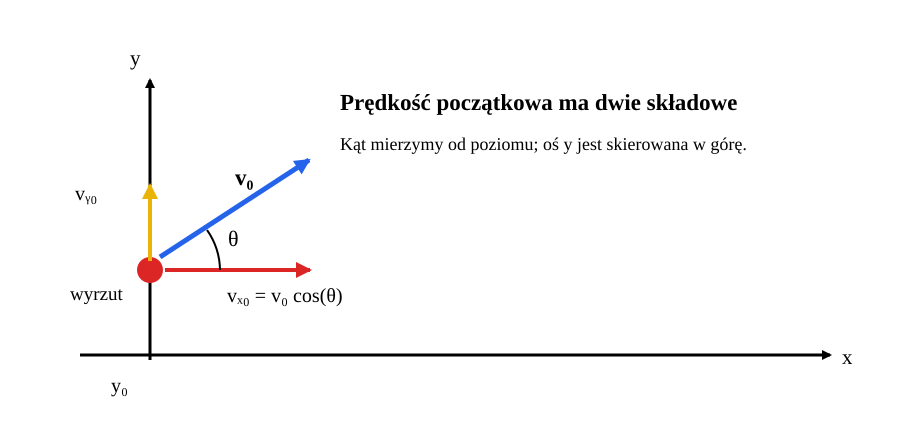
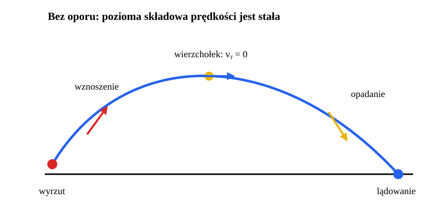
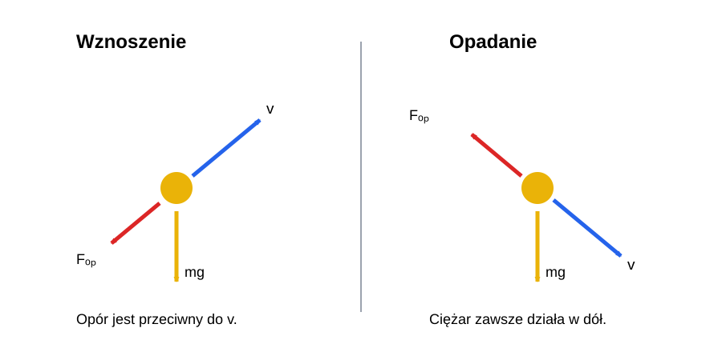
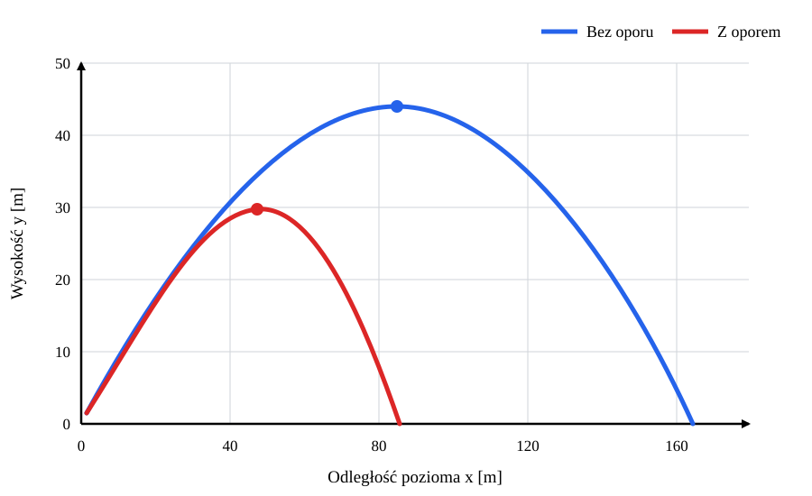
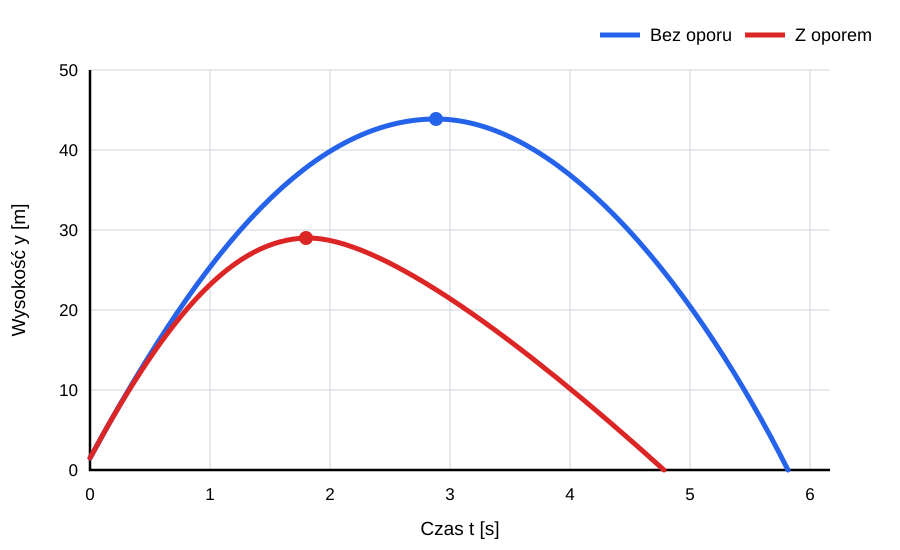
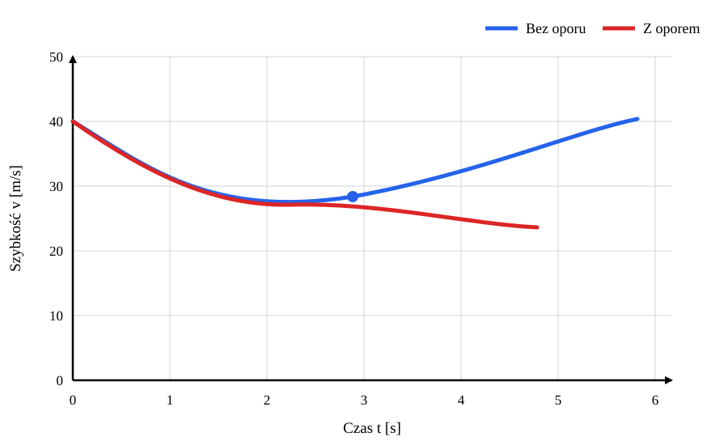
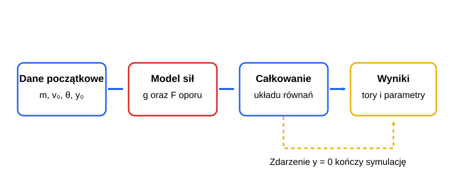
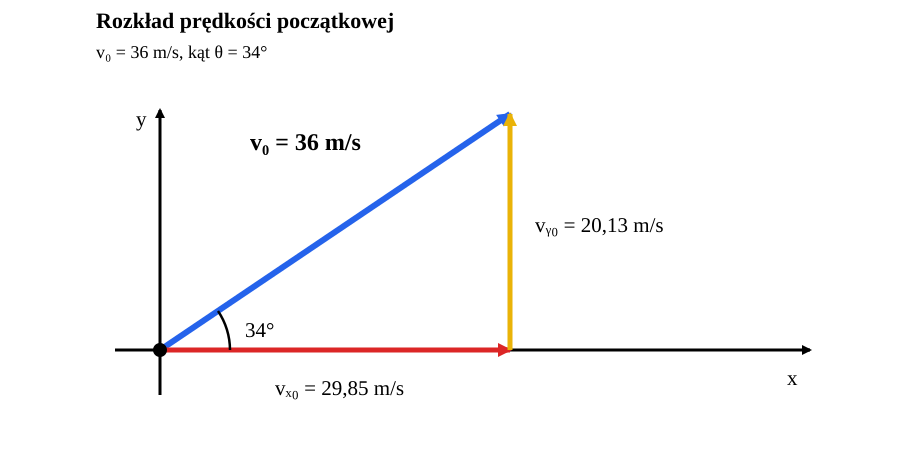

# Rzut ukośny — od modelu idealnego do oporu powietrza

*Raport obliczeniowy i przykład symulacji numerycznej w Pythonie.*

**Temat:** ruch ciała rzuconego pod kątem do poziomu.  
**Metoda:** wyprowadzenie równań, obliczenia analityczne bez oporu, symulacja z oporem kwadratowym.  
**Charakter danych:** przykład modelowy; wyniki nie pochodzą z pomiaru laboratoryjnego.

Rzut ukośny jest prostym modelem ruchu w polu grawitacyjnym. Bez oporu powietrza składowa pozioma prędkości pozostaje stała, a pionowa zmienia się pod wpływem grawitacji. Opór powietrza sprzęga oba kierunki: zmniejsza szybkość, skraca lot i sprawia, że tor przestaje być parabolą.

## Spis treści

1. [Cel i założenia](#1-cel-i-założenia)
2. [Rzut bez oporu powietrza](#2-rzut-bez-oporu-powietrza)
3. [Rzut z oporem powietrza](#3-rzut-z-oporem-powietrza)
4. [Przykład liczbowy i porównanie](#4-przykład-liczbowy-i-porównanie)
5. [Kod i odtwarzanie wyników](#5-kod-i-odtwarzanie-wyników)
6. [Ograniczenia modelu](#6-ograniczenia-modelu)
7. [Wnioski](#7-wnioski)
8. [Dalsza lektura](#8-dalsza-lektura)

---

## 1. Cel i założenia

Celem raportu jest porównanie toru, czasu lotu i zasięgu dla dwóch modeli: idealnego, w którym działa wyłącznie grawitacja, oraz uwzględniającego opór powietrza. W obu przypadkach przyjmujemy te same warunki początkowe, aby różnica wyników wynikała z samego modelu siły oporu.

### 1.1. Układ współrzędnych i warunki początkowe

Początek układu współrzędnych znajduje się na ziemi bezpośrednio pod miejscem wyrzutu. Oś $x$ jest pozioma i skierowana zgodnie z ruchem pocisku, a oś $y$ jest pionowa i skierowana ku górze. Ciało startuje z wysokości $y_0$ z szybkością $v_0$ pod kątem $	heta$ do poziomu.

Składowe prędkości początkowej wynoszą:

$$
v_{x0}=v_0\cos\theta,
\qquad
v_{y0}=v_0\sin\theta.
$$



*Rysunek 1. Prędkość początkową rozkładamy na składową poziomą i pionową.*

Za moment lądowania uznajemy pierwszą chwilę po starcie, dla której $y=0$. Pomijamy wiatr, obrót ciała, zmianę gęstości powietrza z wysokością i nierówności terenu.

### 1.2. Symbole i jednostki

| Symbol | Znaczenie | Jednostka SI |
| :--- | :--- | :---: |
| $x$, $y$ | współrzędne położenia | $\mathrm{m}$ |
| $v_x$, $v_y$ | składowe prędkości | $\mathrm{m/s}$ |
| $v$ | szybkość, $v=\sqrt{v_x^2+v_y^2}$ | $\mathrm{m/s}$ |
| $a_x$, $a_y$ | składowe przyspieszenia | $\mathrm{m/s^2}$ |
| $m$ | masa ciała | $\mathrm{kg}$ |
| $g$ | przyspieszenie ziemskie | $\mathrm{m/s^2}$ |
| $\theta$ | kąt wyrzutu względem poziomu | $^\circ$ lub $\mathrm{rad}$ |
| $\rho$ | gęstość powietrza | $\mathrm{kg/m^3}$ |
| $C_d$ | bezwymiarowy współczynnik oporu | $1$ |
| $A$ | pole powierzchni czołowej | $\mathrm{m^2}$ |

## 2. Rzut bez oporu powietrza

### 2.1. Równania ruchu

W modelu idealnym jedyną siłą działającą na ciało po wyrzuceniu jest ciężar $\vec{F}_g=(0,-mg)$. Z drugiej zasady Newtona:

$$
m\ddot{x}=0,
\qquad
m\ddot{y}=-mg.
$$

Po skróceniu przez masę otrzymujemy stałe przyspieszenia $a_x=0$ i $a_y=-g$. Dla warunków początkowych $x(0)=0$ oraz $y(0)=y_0$ rozwiązania są następujące:

$$
x(t)=v_0\cos\theta\,t,
\qquad
y(t)=y_0+v_0\sin\theta\,t-\frac{1}{2}gt^2.
$$

Prędkość w każdej chwili wynosi:

$$
v_x(t)=v_0\cos\theta,
\qquad
v_y(t)=v_0\sin\theta-gt.
$$

### 2.2. Tor, wierzchołek i czas lotu



*Rysunek 2. W najwyższym punkcie toru składowa pionowa prędkości jest równa zeru.*

Eliminując czas $t=x/(v_0\cos\theta)$, dostajemy równanie toru:

$$
y(x)=y_0+x\tan\theta-
\frac{g x^2}{2v_0^2\cos^2\theta}.
$$

Jest to parabola. W najwyższym punkcie $v_y=0$, zatem:

$$
t_{\mathrm{w}}=\frac{v_0\sin\theta}{g},
\qquad
x_{\mathrm{w}}=\frac{v_0^2\sin(2\theta)}{2g},
\qquad
y_{\max}=y_0+\frac{v_0^2\sin^2\theta}{2g}.
$$

Chwilę lądowania wyznacza dodatni pierwiastek równania $y(t)=0$:

$$
t_{\mathrm{lot}}=
\frac{v_0\sin\theta+\sqrt{(v_0\sin\theta)^2+2gy_0}}{g}.
$$

Zasięg poziomy to $R=x(t_{\mathrm{lot}})$. Dla startu i lądowania na tej samej wysokości ($y_0=0$) wzór upraszcza się do $R=v_0^2\sin(2\theta)/g$. Wtedy, przy ustalonej szybkości początkowej, największy zasięg występuje dla $\theta=45^\circ$. Dla $y_0>0$ kąt maksymalnego zasięgu nie musi wynosić $45^\circ$.

### 2.3. Energia w modelu idealnym

Pomijając opór, energia mechaniczna jest zachowana:

$$
E=\frac{1}{2}mv^2+mgy=\mathrm{const}.
$$

W czasie wznoszenia energia kinetyczna maleje, a potencjalna rośnie. Podczas opadania zachodzi odwrotna przemiana. Nie oznacza to, że szybkość maleje przez cały lot: po osiągnięciu wierzchołka zaczyna rosnąć.

## 3. Rzut z oporem powietrza

### 3.1. Model oporu kwadratowego

Dla ciała poruszającego się w powietrzu przyjmujemy często opór proporcjonalny do kwadratu szybkości. Wektor siły jest przeciwnie skierowany do prędkości:

$$
\vec{F}_{\mathrm{op}}=-\frac{1}{2}\rho C_d A\,v\vec{v}.
$$

Współczynnik $C_d$ zależy między innymi od kształtu ciała i liczby Reynoldsa. Wprowadzając $k=\tfrac{1}{2}\rho C_d A$, możemy zapisać równania składowych:

$$
\dot{x}=v_x,
\qquad
\dot{y}=v_y,
$$

$$
\dot{v}_x=-\frac{k}{m}v v_x,
\qquad
\dot{v}_y=-g-\frac{k}{m}v v_y,
\qquad
v=\sqrt{v_x^2+v_y^2}.
$$

Opór ma składową poziomą i pionową. Wskutek tego $v_x$ nie jest stałe, a tor nie jest parabolą. Zależność od $v=\sqrt{v_x^2+v_y^2}$ sprawia też, że równań nie da się w ogólności rozwiązać prostymi wzorami z poprzedniej sekcji. W przykładzie numerycznie całkujemy układ czterech równań pierwszego rzędu.

### 3.2. Kontrola kierunku siły i energii



*Rysunek 3. Ciężar zawsze jest skierowany w dół, natomiast siła oporu jest przeciwnie skierowana do prędkości.*

Iloczyn skalarny siły oporu i prędkości jest nieujemny po zmianie znaku:

$$
\vec{F}_{\mathrm{op}}\cdot\vec{v}=-kv^3\leq 0.
$$

Opór zawsze odbiera energię mechaniczną. Nie „ciągnie” jednak ciała wyłącznie w dół: podczas ruchu w górę jego składowa pionowa jest skierowana w dół, a podczas spadania w dół — ku górze. W obu przypadkach siła oporu jest przeciwna do chwilowej prędkości.

### 3.3. Prędkość graniczna

Przy pionowym spadaniu i oporze kwadratowym prędkość graniczną otrzymujemy, równoważąc ciężar i wartość oporu:

$$
mg=kv_{\mathrm{gr}}^2,
\qquad
v_{\mathrm{gr}}=\sqrt{\frac{mg}{k}}
=\sqrt{\frac{2mg}{\rho C_d A}}.
$$

Jest to graniczna szybkość dla idealizowanego spadania pionowego przy stałych $\rho$ i $C_d$. W rzucie ukośnym trajektoria nie osiąga w ogólności tego prostego stanu równowagi.

## 4. Przykład liczbowy i porównanie

Porównujemy lot modelowej piłki baseballowej, wyrzuconej z wysokości $1{,}50\,\mathrm{m}$ z szybkością $40{,}0\,\mathrm{m/s}$. Dla powietrza przyjmujemy $\rho=1{,}225\,\mathrm{kg/m^3}$, a dla piłki: $m=0{,}145\,\mathrm{kg}$, promień $r=0{,}0366\,\mathrm{m}$ i $C_d=0{,}47$. Pole czołowe to $A=\pi r^2$. Porównamy trzy kąty wyrzutu przy niezmienionych pozostałych parametrach.

### 4.1. Zmiana kąta wyrzutu

| Kąt $\theta$ | Model | Czas lotu [s] | Maks. wysokość [m] | Zasięg [m] |
| :---: | :--- | ---: | ---: | ---: |
| $30^\circ$ | bez oporu | 4,151 | 21,887 | 143,800 |
| $30^\circ$ | opór kwadratowy | 3,556 | 16,349 | 83,084 |
| $45^\circ$ | bez oporu | 5,819 | 42,275 | 164,585 |
| $45^\circ$ | opór kwadratowy | 4,782 | 28,960 | 85,603 |
| $60^\circ$ | bez oporu | 7,105 | 62,662 | 142,109 |
| $60^\circ$ | opór kwadratowy | 5,722 | 40,947 | 71,176 |

Wartości bez oporu wynikają ze wzorów analitycznych. Wyniki z oporem uzyskano numerycznie metodą Rungego–Kutty czwartego rzędu z maksymalnym krokiem $0{,}0005\,\mathrm{s}$. Dla tych parametrów kąt $45^\circ$ daje największy zasięg spośród trzech sprawdzonych kątów w obu modelach. Nie jest to uniwersalna reguła dla dowolnej wysokości startu, szybkości i oporu.

W przypadku kąta $45^\circ$ opór zmniejsza zasięg o około $48\%$, maksymalną wysokość o około $31\%$ i czas lotu o około $18\%$. Różne procentowe zmiany wynikają z tego, że siła oporu zależy od szybkości oraz jej kierunku. Nie można poprawnie uwzględnić jej przez samo zmniejszenie przyspieszenia grawitacyjnego.

### 4.2. Trzy wykresy dla kąta $45^\circ$

Pierwszy wykres porównuje kształt toru. Drugi pokazuje, jak wysokość zmienia się w czasie, a trzeci przedstawia zmianę szybkości. Wszystkie dotyczą tych samych warunków początkowych i tych samych modeli co wiersze tabeli dla $45^\circ$.



*Rysunek 4. Opór obniża wierzchołek toru i wyraźnie skraca zasięg.*



*Rysunek 5. Maksymalna wysokość jest mniejsza z oporem, a lądowanie następuje wcześniej.*



*Rysunek 6. Bez oporu szybkość jest najmniejsza w wierzchołku toru. Z oporem maleje również składowa pozioma.*

### 4.3. Jak odczytać wynik symulacji?



*Rysunek 7. Symulacja z oporem kończy się, gdy solver wykryje osiągnięcie poziomu gruntu.*

Przy $30^\circ$ piłka leci niżej i krócej niż przy $45^\circ$, ale zachowuje większą część ruchu w kierunku poziomym. Przy $60^\circ$ wznosi się najwyżej i pozostaje w powietrzu najdłużej, jednak duża część prędkości początkowej jest skierowana pionowo. Opór szczególnie ogranicza zasięg tego stromego rzutu, bo szybkość i czas spędzony w powietrzu nie przekładają się wprost na przesunięcie poziome.

### 4.4. Dodatkowy przykład

W tym dodatkowym przykładzie zachowujemy parametry piłki, powietrza i wysokość początkową z poprzedniego przykładu. Zmieniamy wyłącznie szybkość i kąt wyrzutu. Wektor prędkości początkowej rozkłada się na składowe:

$$
v_{x0}=36\cos(34^\circ)\approx29{,}85\,\mathrm{m/s},
\qquad
v_{y0}=36\sin(34^\circ)\approx20{,}13\,\mathrm{m/s}.
$$



*Rysunek 8. Długość wektora $v_0$ odpowiada szybkości $36\,\mathrm{m/s}$, a kąt między nim i poziomem wynosi $34^\circ$.*

| Model | Czas lotu [s] | Maks. wysokość [m] | Zasięg [m] |
| :--- | ---: | ---: | ---: |
| Bez oporu powietrza | 4,177 | 22,155 | 124,675 |
| Z oporem kwadratowym | 3,626 | 16,943 | 75,314 |

Bez oporu składowa pozioma pozostaje stała, a pionowa maleje z przyspieszeniem $g$. Po uwzględnieniu oporu obie składowe prędkości zmieniają się w czasie, dlatego tor jest krótszy i niższy. Ten przypadek jest osobnym obliczeniem; nie należy do porównania kątów omawianego w punkcie 4.3.

## 5. Kod i odtwarzanie wyników

Poniższy skrypt używa NumPy, SciPy i Matplotlib. Można uruchomić go w notebooku Google Colab albo lokalnie po zainstalowaniu bibliotek:

```bash
python -m pip install numpy scipy matplotlib
```

Kod oblicza rozwiązanie analityczne bez oporu, numeryczne z oporem i rysuje porównanie torów. Zdarzenie $y=0$ zatrzymuje całkowanie w chwili lądowania.

```python
import math
import numpy as np
import matplotlib.pyplot as plt
from scipy.integrate import solve_ivp

g = 9.81
m = 0.145
radius = 0.0366
rho = 1.225
Cd = 0.47
v0 = 40.0
angle = math.radians(45.0)
y0 = 1.5
area = math.pi * radius**2
k = 0.5 * rho * Cd * area
vx0 = v0 * math.cos(angle)
vy0 = v0 * math.sin(angle)

# Rozwiązanie analityczne bez oporu.
t_vacuum = (vy0 + math.sqrt(vy0**2 + 2 * g * y0)) / g
t_ideal = np.linspace(0, t_vacuum, 500)
x_ideal = vx0 * t_ideal
y_ideal = y0 + vy0 * t_ideal - 0.5 * g * t_ideal**2
ymax_ideal = y0 + vy0**2 / (2 * g)

# Stan: x, y, vx, vy. Opór działa przeciwnie do wektora prędkości.
def equations(t, state):
	x, y, vx, vy = state
	speed = math.hypot(vx, vy)
	return (
		vx,
		vy,
		-(k / m) * speed * vx,
		-g - (k / m) * speed * vy,
	)

def landing(t, state):
	return state[1]

landing.terminal = True
landing.direction = -1

solution = solve_ivp(
	equations,
	(0, 20),
	(0, y0, vx0, vy0),
	events=landing,
	max_step=0.0005,
	rtol=1e-9,
	atol=1e-11,
)

t_drag = solution.t
x_drag, y_drag = solution.y[0], solution.y[1]
flight_drag = solution.t_events[0][0]
range_drag = solution.y_events[0][0][0]
height_drag = np.max(y_drag)
range_ideal = x_ideal[-1]

print(f"Bez oporu: czas = {t_vacuum:.3f} s, "
	  f"wysokość = {ymax_ideal:.3f} m, zasięg = {range_ideal:.3f} m")
print(f"Z oporem:  czas = {flight_drag:.3f} s, "
	  f"wysokość = {height_drag:.3f} m, zasięg = {range_drag:.3f} m")

plt.figure(figsize=(9, 5.5))
plt.plot(x_ideal, y_ideal, label="Bez oporu", linewidth=2.4)
plt.plot(x_drag, y_drag, label="Z oporem kwadratowym", linewidth=2.4)
plt.scatter([0, range_ideal, range_drag], [y0, 0, 0], s=35, zorder=3)
plt.xlabel("Odległość pozioma x [m]")
plt.ylabel("Wysokość y [m]")
plt.title("Rzut ukośny: porównanie modeli")
plt.grid(alpha=0.25)
plt.legend()
plt.tight_layout()
plt.show()
 
# Wysokość w funkcji czasu.
plt.figure(figsize=(9, 5.5))
plt.plot(t_ideal, y_ideal, label="Bez oporu", linewidth=2.4)
plt.plot(t_drag, y_drag, label="Z oporem kwadratowym", linewidth=2.4)
plt.xlabel("Czas t [s]")
plt.ylabel("Wysokość y [m]")
plt.title("Wysokość w czasie dla kąta 45°")
plt.grid(alpha=0.25)
plt.legend()
plt.tight_layout()
plt.show()

# Szybkosc w funkcji czasu.
speed_ideal = np.hypot(vx0, vy0 - g * t_ideal)
speed_drag = np.hypot(solution.y[2], solution.y[3])
plt.figure(figsize=(9, 5.5))
plt.plot(t_ideal, speed_ideal, label="Bez oporu", linewidth=2.4)
plt.plot(t_drag, speed_drag, label="Z oporem kwadratowym", linewidth=2.4)
plt.xlabel("Czas t [s]")
plt.ylabel("Szybkość v [m/s]")
plt.title("Szybkość w czasie dla kąta 45°")
plt.grid(alpha=0.25)
plt.legend()
plt.tight_layout()
plt.show()

# Tabela porownawcza dla trzech katow wyrzutu.
for angle_degrees in (30, 45, 60):
	angle_value = math.radians(angle_degrees)
	initial_vx = v0 * math.cos(angle_value)
	initial_vy = v0 * math.sin(angle_value)
	flight_ideal = (initial_vy + math.sqrt(initial_vy**2 + 2 * g * y0)) / g
	height_ideal = y0 + initial_vy**2 / (2 * g)
	range_ideal_angle = initial_vx * flight_ideal
	result = solve_ivp(
		equations,
		(0, 20),
		(0, y0, initial_vx, initial_vy),
		events=landing,
		max_step=0.0005,
		rtol=1e-9,
		atol=1e-11,
	)
	flight_drag_angle = result.t_events[0][0]
	height_drag_angle = np.max(result.y[1])
	range_drag_angle = result.y_events[0][0][0]
	print(f"{angle_degrees} deg: bez oporu "
		f"{flight_ideal:.3f} s, {height_ideal:.3f} m, {range_ideal_angle:.3f} m; "
		f"z oporem {flight_drag_angle:.3f} s, "
		f"{height_drag_angle:.3f} m, {range_drag_angle:.3f} m")

# Osobny przyklad: v0 = 36 m/s, kat = 34 stopnie.
extra_v0 = 36.0
extra_angle = math.radians(34.0)
extra_vx0 = extra_v0 * math.cos(extra_angle)
extra_vy0 = extra_v0 * math.sin(extra_angle)
extra_flight_ideal = (
	extra_vy0 + math.sqrt(extra_vy0**2 + 2 * g * y0)
) / g
extra_height_ideal = y0 + extra_vy0**2 / (2 * g)
extra_range_ideal = extra_vx0 * extra_flight_ideal
extra_solution = solve_ivp(
	equations,
	(0, 20),
	(0, y0, extra_vx0, extra_vy0),
	events=landing,
	max_step=0.0005,
	rtol=1e-9,
	atol=1e-11,
)
print(f"Przyklad 36 m/s, 34 deg: vx0 = {extra_vx0:.2f} m/s, "
	f"vy0 = {extra_vy0:.2f} m/s")
print(f"Bez oporu: {extra_flight_ideal:.3f} s, "
	f"{extra_height_ideal:.3f} m, {extra_range_ideal:.3f} m")
print(f"Z oporem: {extra_solution.t_events[0][0]:.3f} s, "
	f"{np.max(extra_solution.y[1]):.3f} m, "
	f"{extra_solution.y_events[0][0][0]:.3f} m")
```

Sprawdzeniem poprawności jest zgodność wydrukowanych wielkości z tabelą z dokładnością wynikającą z zaokrąglenia. Przy zmianie masy, rozmiaru lub współczynnika $C_d$ trzeba ponownie rozwiązać równania; wyniki dla modelu z oporem nie skalują się tak prosto jak w próżni.

## 6. Ograniczenia modelu

- Przyjęto stałą gęstość powietrza oraz stały współczynnik $C_d$.
- Pominięto wiatr, rotację piłki i siłę Magnusa, która może odchylać tor wirującego obiektu.
- Przyjęto, że piłka jest kulą o stałym promieniu, a jej pole czołowe nie zmienia się w czasie.
- Model oporu kwadratowego jest przybliżeniem; rzeczywisty $C_d$ zależy od warunków przepływu.
- Ruch nad płaskim podłożem opisano w dwuwymiarowym układzie współrzędnych.

Wyniki należy więc interpretować jako porównanie dwóch modeli fizycznych dla ustalonych parametrów, a nie precyzyjną prognozę konkretnego rzutu.

## 7. Wnioski

1. Bez oporu powietrza ruch poziomy jest jednostajny, ruch pionowy jednostajnie przyspieszony, a tor stanowi parabolę.
2. Opór kwadratowy zależy od wektora prędkości. Zmienia obie składowe ruchu i powoduje, że analityczne wzory na parabolę nie mają zastosowania.
3. Dla przyjętej piłki i warunków początkowych zasięg modelowy spada z około $164{,}59\,\mathrm{m}$ do $85{,}60\,\mathrm{m}$.
4. Równania z oporem można rozwiązać numerycznie, a jakość obliczeń sprawdzić przez zmniejszanie kroku całkowania i tolerancji solvera.
5. Każdy wynik symulacji należy opisywać razem z założeniami modelu i parametrami, które go wyznaczają.

## 8. Dalsza lektura

- [OpenStax: Projectile Motion](https://openstax.org/books/university-physics-volume-1/pages/4-3-projectile-motion) — ruch pocisku bez oporu powietrza.
- [NASA Glenn: The Drag Equation](https://www1.grc.nasa.gov/beginners-guide-to-aeronautics/drag-equation/) — równanie siły oporu i znaczenie jego parametrów.
